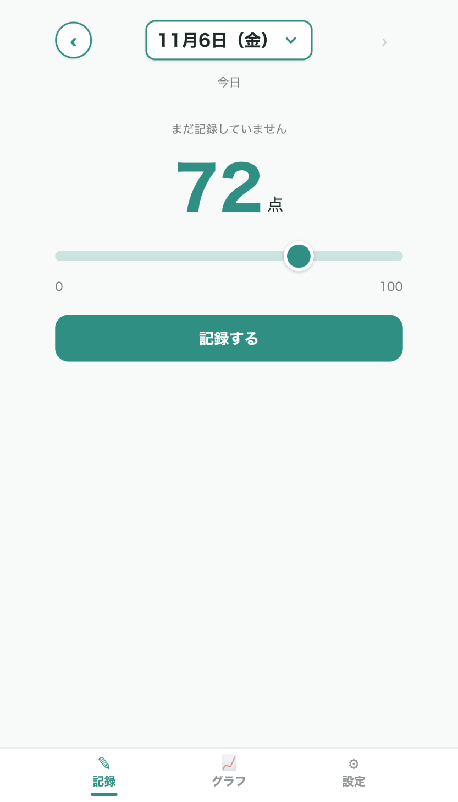
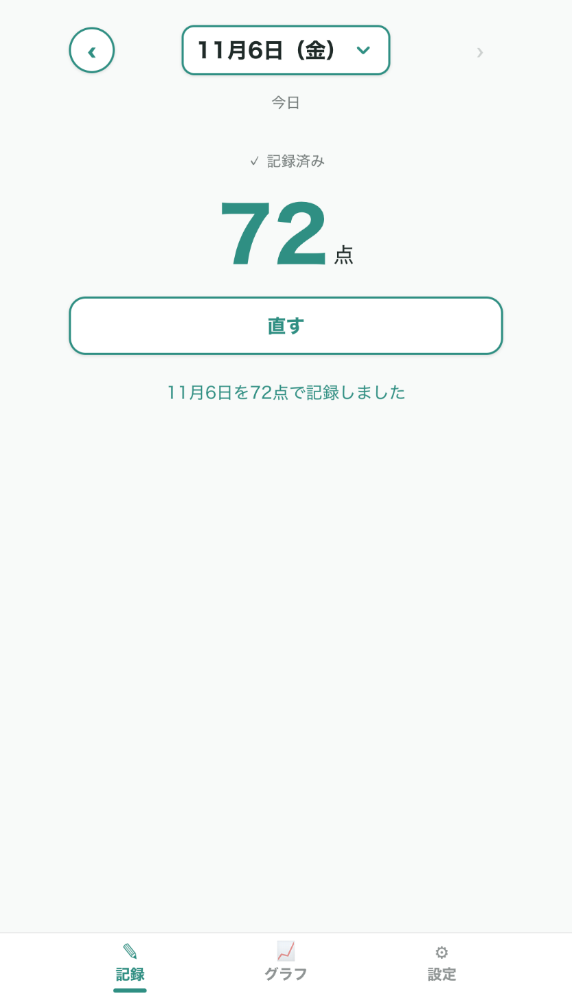
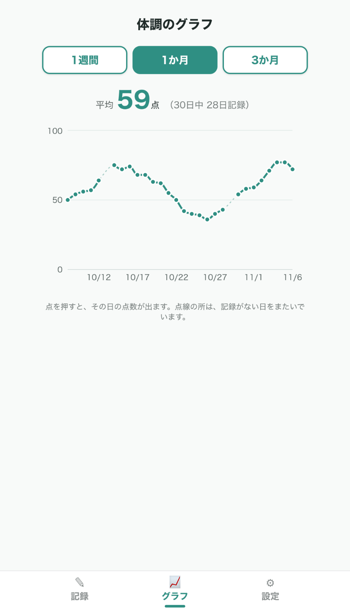
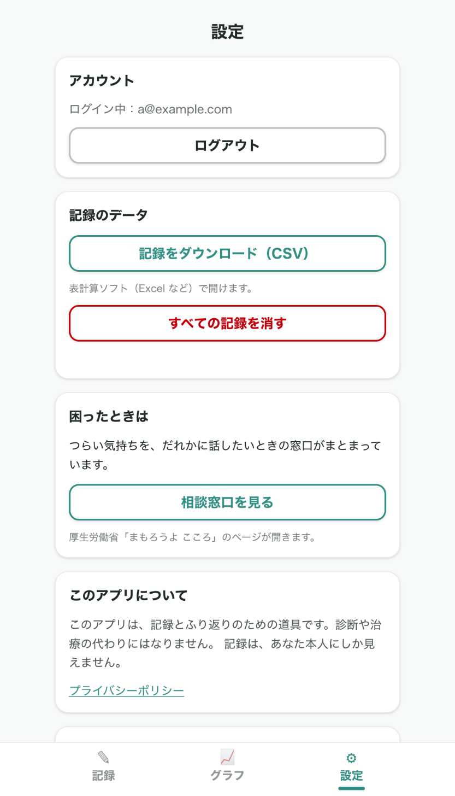
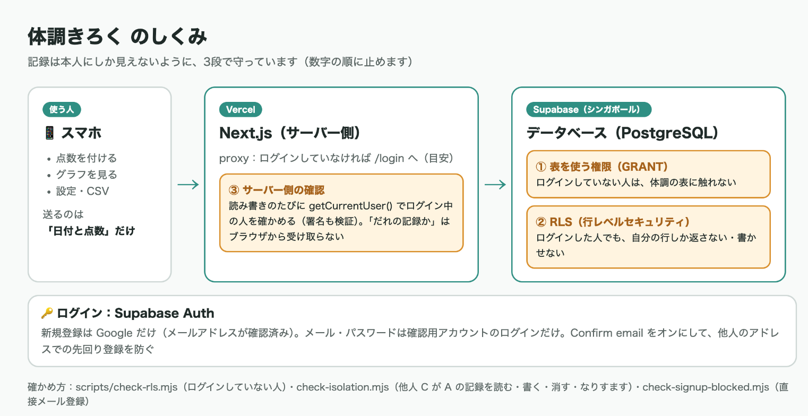

# 体調きろく

うつ病（気分の波がある病気）で通院している人が、毎日の体調を **0〜100 の点数1つ** で記録し、**折れ線グラフ** でふり返るアプリです。

- 公開 URL：https://condition-log-eta.vercel.app
- プライバシーポリシー：https://condition-log-eta.vercel.app/privacy
- 要件定義書：[docs/requirements.md](docs/requirements.md)
- 提出記事：[docs/提出記事.md](docs/提出記事.md)

> このアプリは記録とふり返りのための道具です。診断や治療の代わりにはなりません。
> 公開しているスクリーンショット・確認用アカウントのデータは、すべてダミーです。

## スクリーンショット

| 記録 | 記録したあと | グラフ（1か月） | 設定 |
|---|---|---|---|
|  |  |  |  |



## できること（MVP）

- **記録**：スライダーで 0〜100 点を付ける。記録済みの日は見るだけで、「直す」を押したときだけ上書き・削除できる
- **日付の切り替え**：‹ 日付 ›。日付を押すと月のカレンダーが開き、1回押せばその日へ移る
- **グラフ**：1週間／1か月／3か月の折れ線グラフと平均。記録のない日をまたぐ所は薄い点線
- **設定**：ログアウト／記録の CSV ダウンロード／すべての記録を消す／相談窓口へのリンク／ためしのサンプルデータ
- **ログイン**：Google でログイン・新規登録（確認用アカウントのみ、メールアドレスとパスワードでログイン）

## 記録は本人にしか見えない（3段の守り）

1. **表を使う権限（GRANT）**：ログインしていない人は、体調の表に触れない
2. **RLS（行レベルセキュリティ）**：ログインした人でも、データベースが自分の行しか返さない
3. **サーバー側の確認**：記録の読み書きでは、毎回サーバーでログイン中の人を確かめる。「だれの記録か」はブラウザから受け取らない

確認用のスクリプト（`scripts/`）で、ログインしていない人・他人が読めない／書けないことを確かめています。

## 技術スタック

- Next.js 16（App Router）＋ React 19 ＋ TypeScript ＋ Tailwind CSS v4
- Supabase（Auth＋PostgreSQL＋RLS）
- Recharts（グラフ）
- Vercel（公開）

## ローカルで動かす

```bash
npm install
cp .env.example .env.local   # Supabase の URL と公開用キーを入れる
npm run dev                  # http://localhost:3000
```

データベースの表と RLS は `supabase/migrations/` の SQL を、Supabase の SQL Editor で番号順に実行して作ります。
