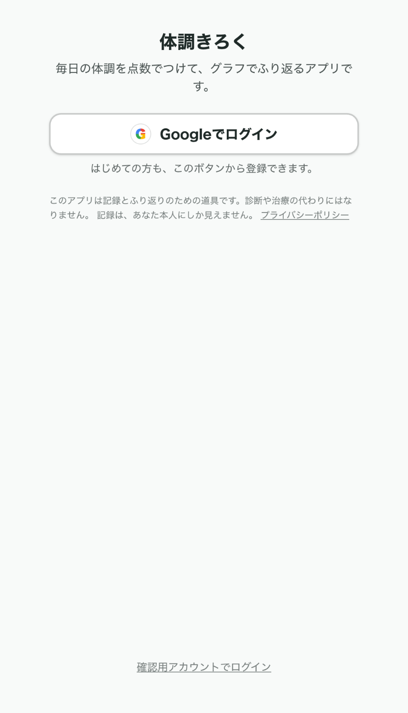
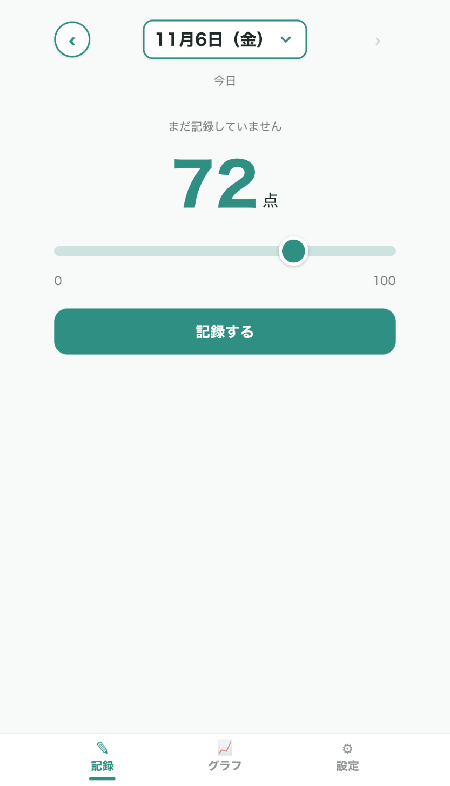
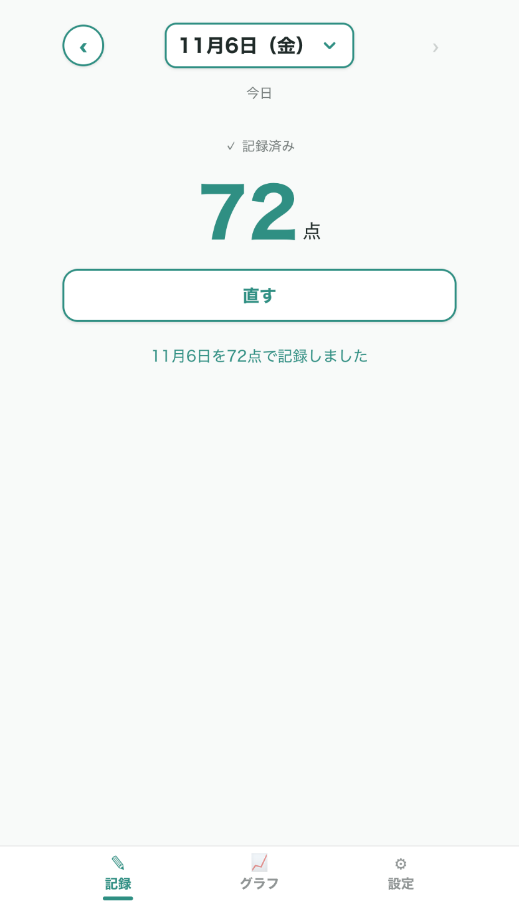
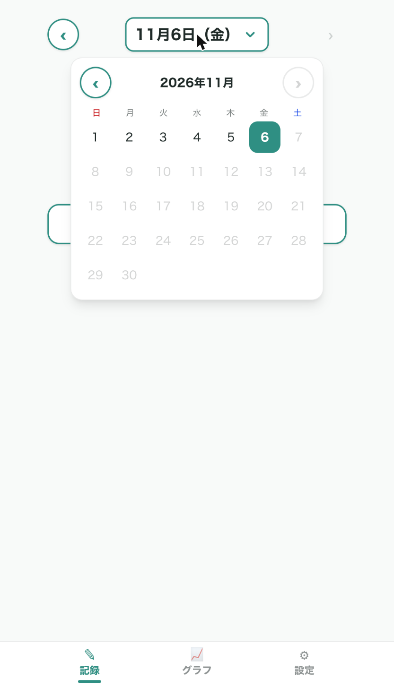
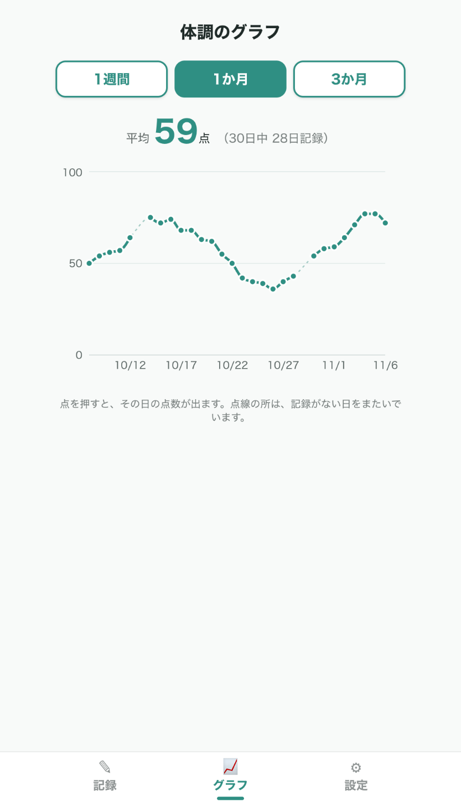
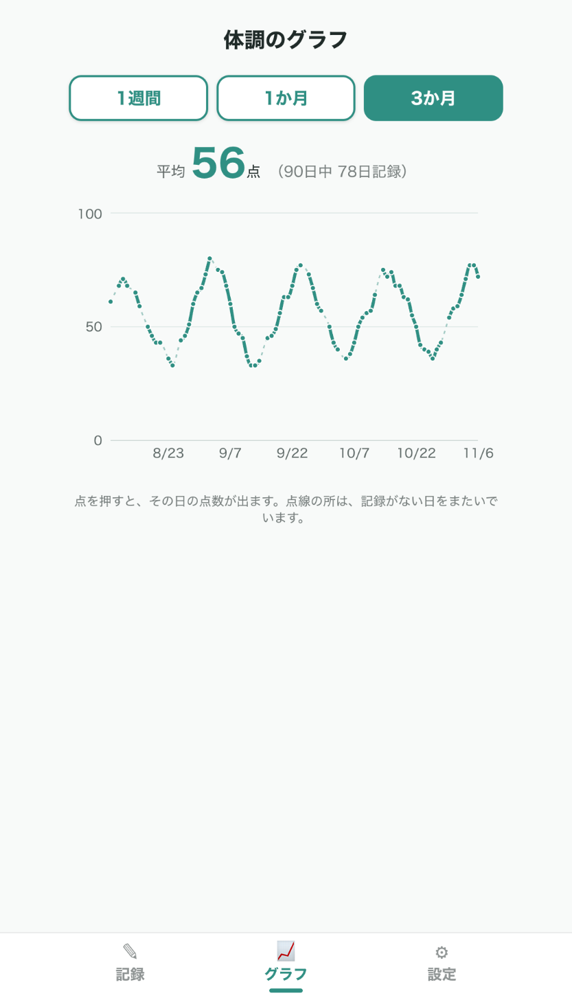
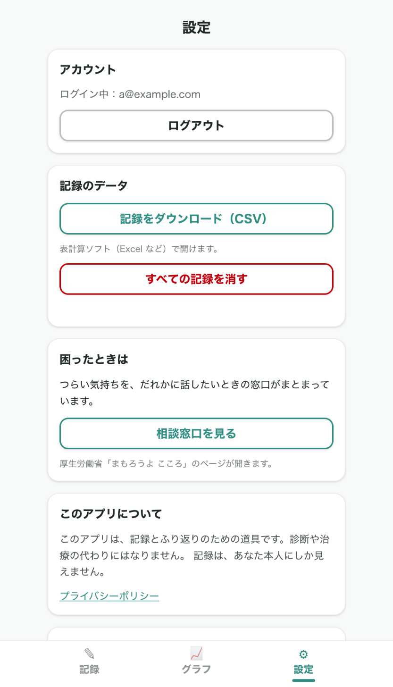
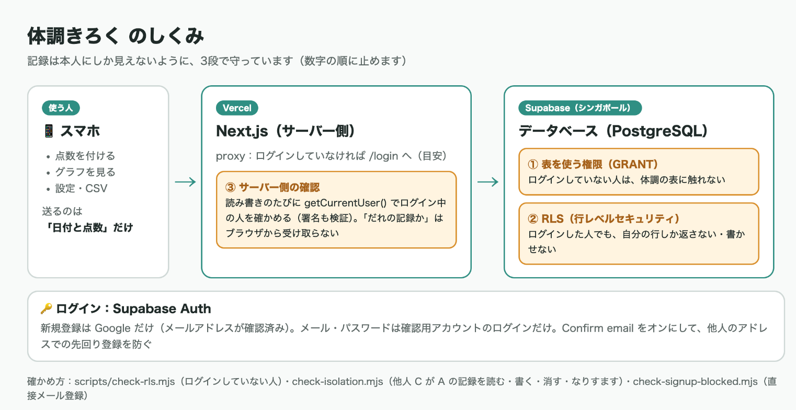

# [課題提出] うつ病の人が毎日つける体調記録アプリ（オリジナルシステム開発 2つ目）を完成させました

> このファイルは提出記事の原稿です（`zsh docs/copy_article.sh` で写真ごとコピーできます）。

## A. 課題概要

### 課題情報

- 課題名：実践編 Section 1-3　オリジナルシステム開発 課題2（1つ目とは異なるテーマで、もう1つオリジナルシステムを開発・公開・記事化する）
- 難易度：★★★★☆（5段階で自己評価）

### 課題要件

- 1つ目と**テーマ・用途が違う**ものにする（1つ目：バイトのシフト管理 → 2つ目：毎日の体調記録）
- 1つ目と同じく、要件定義 → Plan Mode → 実装 → デプロイ → 記事 の流れを再現する
- 1つ目で詰まったポイントを意識して、同じ失敗を繰り返さないように進める
- 記事内で、1つ目と比べてスムーズになった点／改善した進め方を1段落で書く

### ソースコード

- GitHub：https://github.com/Usuke3122378/condition-log
- Google Drive：なし
- 公開URL：https://condition-log-eta.vercel.app/ （プライバシーポリシーは https://condition-log-eta.vercel.app/privacy ）

### 誰のためのツールか

うつ病（気分の波がある病気）で通院している人のためのアプリです。自分自身もうつ病を経験していて、同じ境遇の方から「**体調の点数だけつける機能とか個人的にあれば嬉しいです！**」と言われたのがきっかけです。

調子が悪い日ほど記録が大事なのに、項目の多い日記アプリは、しんどい日には重すぎます。そこで、**0〜100 の点数を1つ付けるだけ**で毎日の記録が終わり、それが**折れ線グラフ**になって体調の波が見えるアプリにしました。

| 困りごと | このアプリでの解決 |
|---|---|
| しんどい日は、たくさん入力する気力がない | 点数を1つ選んで「記録する」だけ。ほかの項目はない |
| 日記の文章だと、良くなっているのか悪くなっているのか分からない | 1週間・1か月・3か月の折れ線グラフと平均で、波が一目で分かる |
| 付け忘れると、続けるのがいやになる | 連続記録の日数（ストリーク）や催促は出さない。付け忘れた日は線が薄い点線になるだけ |
| 夜中に前の日の分を付けたい | ‹ › で1日戻るか、日付を押してカレンダーから選べる |
| 体調の記録を、ほかの人に見られたくない | ログインした本人にしか見えない。3段の守りで、ほかの人やログインしていない人は読めない |

「設計の芯」として、**軽さ最優先・責めない・評価しない（点数が低くても励ましや診断めいたことは言わない）・医療アプリではないと明記する**、の4つを決めて、すべての画面をそれに合わせました。

※ 記事のスクリーンショットは、確認用のダミーアカウント（a@example.com）とサンプルデータで撮っています。

### 成果物のスクリーンショット

ログイン画面。Google でログイン・新規登録する。いちばん下の小さなリンクは、確認テスト用のダミーアカウント専用



記録画面（まだ記録していない日）。スライダーで 0〜100 点を選んで「記録する」を押すだけ



記録したあと。記録済みの日は点数を見るだけになり、うっかり触って上書きしないように「直す」を押したときだけスライダーが出る



日付を押すと月のカレンダーが開き、日にちを1回押せばその日へ移る。未来の日は押せない



グラフ（1か月）。平均点と「30日中◯日記録」。記録のない日をまたぐ所は薄い点線でつなぎ、0点とは区別する



グラフ（3か月）。点を押すと、その日の日付と点数が出る



設定画面。ログアウト・記録のダウンロード（CSV）・すべての記録を消す・相談窓口（厚生労働省「まもろうよ こころ」）へのリンク・注意書き・プライバシーポリシー・ためしのサンプルデータ



## B. 実装内容

### 使用技術

- 言語：TypeScript、SQL（データベースの表と権限のルール）
- フレームワーク：Next.js 16（App Router、Server Actions、Route Handler、proxy）、React 19、Tailwind CSS v4
- データベース：Supabase（PostgreSQL＋RLS。サーバーはシンガポール）
- ログイン：Supabase Auth（Google ログイン。確認用アカウントだけメール・パスワード）
- その他ツール：Recharts（グラフ）、Google Cloud（Google ログインの窓口）、Claude Code（設計・実装・動作確認・スクショ撮影）、Claude in Chrome（ブラウザでの動作確認）、GitHub・GitHub CLI（gh）、Vercel（Hobby プラン。push すると自動で公開し直す）
- 費用：**0円**（すべて無料のサービスだけで動いています）

### 使った Claude Code の機能

| 機能 | 使い方 |
|---|---|
| 要件定義書を一緒に作る | 「コードは書かないで」と伝えて、テーマ・機能・点数の付け方・データの置き場所を相談しながら `docs/requirements.md` を作った。1つ目のフィードバックも貼り付けて、要件に反映してもらった |
| `/init` と CLAUDE.md | プロジェクトの説明書を作り、1つ目のルールに加えて「守りの3段」「ダミーアカウント」「キャッシュの捨て方」などの新しいルールを追記した |
| Plan Mode | S1〜S10 の各ステップに入る前に毎回計画を出してもらい、確認してから実装した |
| AskUserQuestion（選択肢で質問） | 「記録済みの点数を直しやすくするか」「グラフの空白をどう見せるか」などを、図付きの選択肢で比べて自分で決めた |
| Claude in Chrome | ブラウザでボタンを押したりスライダーを動かしたりして、動作確認とスクショ撮影をしてもらった |
| 確認用スクリプト | 「他人の記録が読めないか」を、画面を通さずデータベースに直接試すスクリプトを作ってもらい、何度も実行した |

CLAUDE.md に追記したルール（1つ目から引き継いだもの以外）：

| ルール | ねらい |
|---|---|
| 権限は「二重（のちに3段）の守り」で作る。だれの記録かはブラウザから受け取らない | 1つ目のフィードバック「URL を隠すことと不正アクセスを防ぐことは別」への対応 |
| ログインの確認は `getCurrentUser()` の1か所に集める。proxy は目安 | Next.js のドキュメントに「proxy を本当の確認の代わりにしない」とあるため |
| 表を足すときは RLS と GRANT をセットで書き、SQL をリポジトリに残す | S3 で、新しい表に権限が自動で付かずに詰まったため |
| データを書き換える処理・ログイン・ログアウトでは、ブラウザが覚えているページを捨てる | S5 で、保存前の点数が出る不具合があったため |
| 本名・本物のメールアドレス・本物の体調記録を、コード・スクショ・記事に入れない。ダミーは管理画面で作る | 体調はとても繊細な情報なので |
| 「設計の芯」（軽さ最優先・責めない・評価しない・医療アプリではない） | 画面の文言やデザインを決めるときの基準 |
| MVP は「ボタンひとつ」から小さく作る | 作って見て、要件を変えていく方針 |

### 実装した機能

1. ログイン：Google でログイン・新規登録。確認用アカウントだけ、メールアドレスとパスワードでログイン
2. 点数の記録：スライダーで 0〜100 点（最初は50）。1日1件。記録済みの日は見るだけで、「直す」で上書き・削除
3. 日付の切り替え：‹ 日付 › と、日付を押すと開く月のカレンダー。今日以外のときは「今日にもどる」
4. グラフ：1週間・1か月・3か月の折れ線グラフと平均・記録した日数。記録のない日は薄い点線
5. 設定：ログアウト・CSV ダウンロード・すべての記録を消す・相談窓口・注意書き・サンプルデータ
6. プライバシーポリシー：受け取る情報・使い道・だれが見られるか・保存場所・削除の方法・問い合わせ先

### 工夫したポイント

- **記録は本人にしか見えないように、3段で守りました。** 1つ目のフィードバックで「ログイン・認証を優先すべき」「URL を隠すことと不正アクセスを防ぐことは別なので、サーバー側の認証・権限チェックを」と教えてもらったことへの答えです。
  1. 表を使う権限（GRANT）：ログインしていない人は、体調の表に触れない
  2. RLS（行レベルセキュリティ＝データベース自体に「自分の行しか読めない」ルールを付ける仕組み）：ログインした人でも、自分の行しか返らない
  3. サーバー側の確認：記録を読み書きするたびに、サーバーでログイン中の人を確かめる。保存の処理が受け取るのは「日付と点数」だけで、「だれの記録か」はサーバーが決めるので、ブラウザから別の人になりすませない
- **守れていることを、スクリプトで確かめられるようにしました。** 確認用のダミーアカウント A・C を作り、C が A の記録を読む・書き換える・消す・A になりすまして追加する、をデータベースに直接試します。

```
✓ A が自分の記録を入れられる
✓ C が読む：A の記録は 0 件見えた
✓ C が A の記録を書き換える：0 件変わった
✓ C が A になりすまして追加する：断られた（42501）
✓ C が A の記録を消す：0 件消えた
✓ A の記録は元のまま（42 点）
```

- **同じメールアドレスでの乗っ取りの下準備を防ぎました。** メールの確認なしでメール登録できると、他人が先に本人のアドレスで登録しておき、本人があとで Google ログインしたときに同じアカウントにまとめられるおそれがあります。新規登録は Google（メールアドレス確認済み）だけにし、Supabase の「Confirm email」もオンにして、画面を通らず直接登録されても使えないようにしました。
- **しんどい日を前提にした画面にしました。** 記録は1つの点数だけ。連続記録の日数や催促は出さない。点数が低くても評価しない。相談窓口は設定画面に静かに置く。記録済みの日は「見るだけ」にして、うっかり上書きしないようにしました。
- **グラフの空白を正直に、でも読み取れるようにしました。** 付け忘れた日を 0点にすると「最悪の日」に見えてしまいます。記録のある日どうしは太い線、記録のない日をまたぐ所は薄い点線にしました。
- **体調のデータの扱いを、画面でも約束しました。** CSV のダウンロードは途中のサーバーやブラウザに残らない設定にし、プライバシーポリシーに「受け取る情報・だれが見られるか・どこに保存するか・どう消せるか」を書きました。



## C. 実装過程

### 開発の流れ

#### 11月3日（1）要件定義書を一緒に作る

やったこと：課題文を貼り、「要件定義から一緒に作りたい。こちらがいいと言うまでコードは書かないで」と伝えた。テーマ（うつ病の人の体調記録）と、同じ境遇の方に言われた言葉を伝えて、機能・点数の付け方・データの置き場所・だれが見るかを相談しながら `docs/requirements.md` を作った。

遭遇したエラー：`（エラーはなし）`

Cursorに聞いた内容：（Claude Code に）1つ目の課題でもらったフィードバック（ログイン・認証、サーバー側の権限チェック）を貼って、「それも踏まえたい」と伝えた。

Cursorの回答：（Claude Code の回答）データをスマホの中だけに置く案もあるが、フィードバックに正面から応えるなら、ログイン＋データベース＋「サーバー側の確認」と「データベースのルール（RLS）」の二重の守りがよい。家族と共有する機能は「一部だけ見せる権限」が必要で難しいので、後回しにする。

実際に試したこと：

1. 点数は100点満点のスライダー（最初は50）、ログインは二重の守り、最初は自分だけが見る、と決めた。「時間を気にせず v2.0 まで全部やる」と決めたあと、「MVP はボタンひとつから小さく作りたい」と伝えて、作る順番（S1〜S10）を決めた
    - 結果：機能（F-01〜F-21）・画面・権限のルール・確認テストの表まで入った要件定義書ができた

学んだこと：フィードバックを要件の最初に入れておくと、設計の中心がぶれない。

---

#### 11月3日（2）ボタンひとつから作る／スマホで開けない

やったこと：`/init` で CLAUDE.md を作り、Plan Mode で全体の作りを決めた。S1 は「記録する」ボタンひとつ（押すと「記録しました」）、S2 は 0〜100 のスライダーと大きな数字。

遭遇したエラー：`スマホで開けない`

Cursorに聞いた内容：（Claude Code に）「スマホで開けない」と伝えた。

Cursorの回答：（Claude Code の回答）スマホで localhost と打つと、パソコンではなくスマホ自身を指す。パソコンの Wi-Fi 上のアドレス（192.168.0.80）で開く。さらにこの版の Next.js は、開発中に localhost 以外から開かれるとボタンなどを動かす仕組みを止めるので、`next.config.ts` の `allowedDevOrigins` で許可する。

実際に試したこと：

1. 設定を足して、スマホでスライダーを動かした
    - 結果：開けた。11月5日には Wi-Fi の番号が 0.81 に変わってまた開けなくなったので、番号が変わらないパソコンの名前（MacBook-Air.local）でも開けるようにした

学んだこと：小さく作ると、最初の画面の段階でスマホでの確認ができ、早く問題に気づける。

---

#### 11月5日（3）Supabase の準備で、つながらない・権限がない

やったこと：Supabase のプロジェクトを作り、点数の表と RLS の SQL を実行して、`.env.local` に URL と公開用キーを入れた。ログインしていない人が読めないことを確かめるスクリプトを動かした。

遭遇したエラー：`PGRST125 Invalid path specified in request URL` → 直したら `42501 permission denied for table entries`

Cursorに聞いた内容：（Claude Code に）スクリプトの結果を見てもらった。

Cursorの回答：（Claude Code の回答）1つ目は、URL の最後に `/rest/v1/` が付いていたため。2つ目は、新しい Supabase では新しい表に権限が自動で付かないため。ログインしていない人が止まるのは安全だが、このままだとログインした本人も保存できない。「ログインしていない人には何も許さない／ログインした人は表を使えて、行は RLS で絞る」を SQL ではっきり書く。また、スクリプトが URL の間違いでも「断られた」と合格にしていたので、「権限で断られた（42501）」のときだけ合格にする。

実際に試したこと：

1. 権限の SQL（002）を実行し、スクリプトを直して実行した
    - 結果：「ログインしていない人は、読めない・書けない ✓」。守りが3段（GRANT・RLS・サーバー側）になった。リージョンは画面で東京を選べず、シンガポールになった

学んだこと：守りの確認は「断られたか」だけでなく、**正しい理由で断られたか**まで見る。

---

#### 11月5日（4）ログインを作る

やったこと：メール・パスワードでのログインと、ログインしていないと記録画面に入れない仕組みを作った。ログインの確認はサーバー側の `getCurrentUser()` の1か所に集めた。

遭遇したエラー：`Next.js encountered the unstable value Date.now() while prerendering`。ほかに、ログインに失敗したあと新規登録を押しても、前のエラー「パスワードが違います」が残った

Cursorに聞いた内容：（Claude Code が開発中の警告とブラウザの動きに気づいた）

Cursorの回答：（Claude Code の回答）ログインの確認の中で有効期限を時刻で調べているので、「この確認はアクセスのたびに行う処理」と Next.js に伝える（`connection()`）。エラーが残るのは、ログインと新規登録の結果を別々に持っていたため。1つにまとめる。

実際に試したこと：

1. 直したあと、新規登録・ログアウト・間違ったパスワード・同じメールでの登録をブラウザで試してもらった
    - 結果：すべて日本語のメッセージで正しく出た。自分がスマホで触ったときに「新規登録でも既存アカウントのように入力を求められる」と感じたので、上に「ログイン／はじめての方」の切り替えを付けた

学んだこと：AI が気づく不具合と、自分が触って気づく分かりにくさは別もの。両方必要。

---

#### 11月5日（5）記録し直すと、前の点数のまま

やったこと：点数をデータベースに保存できるようにした。保存の処理が受け取るのは点数だけで、「だれの記録か」と日付はサーバーで決める。A と C の確認テストのスクリプトも作った。

遭遇したエラー：`（エラーはなし）記録し直してすぐログインし直すと、前の点数のまま出る`

Cursorに聞いた内容：（Claude Code に）「記録し直すと前のままで残っている。反映が遅いのでは？」と伝えた。

Cursorの回答：（Claude Code の回答）保存はできている。この版の Next.js は、表示したページをブラウザ側で覚えて使い回すので、保存前の記録画面が出ていた。保存・ログイン・ログアウトのときに覚えているページを捨てる（`revalidatePath`）。ログイン・ログアウトでも捨てるのは、同じスマホで別の人がログインしたときに、前の人の画面が一瞬でも出ないようにするため。

実際に試したこと：

1. 同じ流れ（記録し直す → すぐログアウト → すぐログイン）で試してもらった
    - 結果：新しい点数が出た。CLAUDE.md にもルールとして追記した

学んだこと：1つ目の「名前を切り替えると前の人の日付が一瞬出る」と同じ種類の問題。体調の記録では「前の人の画面が出る」はプライバシーの問題になるので、特に大事。

---

#### 11月5日（6）触ってみて、記録画面を作り直す（壁打ち）

やったこと：日付の切り替え（今日・昨日・‹ ›・日付を選ぶ）を作った。触ってみて、2つ気になったので Claude Code に壁打ちしてもらった。

遭遇したエラー：`（エラーはなし）記録済みの点数がすぐ動かせて、誤操作しそう。「今日」「昨日」と ‹ › の機能が重なっている`

Cursorに聞いた内容：（Claude Code に）「それぞれメリットデメリットを挙げて方向性を固めさせて」と頼んだ。

Cursorの回答：（Claude Code の回答）記録済みの点数は、A 今のまま／B 見るだけ＋「直す」ボタン／C 上書きのときに確認、の3案。日付は、A 今のまま／B 日付を押すとメニュー／C 日付を押すとすぐカレンダー、の3案。それぞれの図と良い点・気になる点を出した（おすすめはどちらも B と C）。

実際に試したこと：

1. 「見るだけ＋直す」と「‹ 日付 › ＋カレンダー」を選んだ。さらに、スマホ標準の日付選びは「完了／✓」を押す手間があったので、日にちを1回押せば移る**アプリの中の月カレンダー**を作ってもらった。ボタンが背景と見分けにくい・日付の印が小さい、も直した
    - 結果：「今日はつけ終わった」と一目で分かる、すっきりした記録画面になった

学んだこと：作って触ってみないと分からないことが多い。「作って見てから変える」と最初に決めておいたので、迷わず直せた。

---

#### 11月5日（7）グラフの線が切れ切れで、波が読めない

やったこと：1週間・1か月・3か月の折れ線グラフと平均を作った。

遭遇したエラー：`（エラーはなし）記録のない日で線が切れ、3か月だと波が読み取れない。前後に記録がない1日だけの点が見えない`

Cursorに聞いた内容：（Claude Code が3か月の表示で気づき、見せ方を選択肢で聞いてきた）

Cursorの回答：（Claude Code の回答）体調が悪いと付け忘れる日も増えるので、ここの見せ方は大事。①細い点線でつなぐ ②今のまま途切れさせる ③全部つなぐ（記録のない日が分からなくなる）。おすすめは①。

実際に試したこと：

1. 「細い点線でつなぐ」を選び、1日だけの点も必ず出すようにした
    - 結果：とびとびの記録でも、波が読み取れるようになった。平均と記録日数は、手で計算した値と一致した

学んだこと：「正直な表示」と「読み取りやすさ」は両立できる。

---

#### 11月5日（8）設定画面とサンプルデータ

やったこと：ログアウト・CSV ダウンロード・すべての記録を消す・相談窓口・ためしのサンプルデータを作った。

遭遇したエラー：`（エラーはなし）サンプルの点数が毎日ばらばらに上下して、本物の記録らしくない`

Cursorに聞いた内容：（Claude Code がグラフで気づいた）

Cursorの回答：（Claude Code の回答）前の日から少しずつ動く形にして、なだらかな波にする。サンプルは「記録のない日」にだけ入れて、自分で付けた記録は上書きしない。

実際に試したこと：

1. 今日を77点で記録してからサンプルを入れた
    - 結果：77点はそのまま残り、グラフになだらかな波が出た。この記事のスクショもサンプルで撮った

学んだこと：1つ目の反省「スクショ用のデータを最初から用意しておく」を計画に入れておいたので、撮影で困らなかった。

---

#### 11月5日（9）Google ログインと、乗っ取りの下準備

やったこと：Google ログインを作った。Google Cloud で窓口を作り、Supabase に登録した。

遭遇したエラー：`（エラーはなし）Claude Code から「同じメールアドレスで、乗っ取りの下準備ができてしまうおそれがある」と指摘された`

Cursorに聞いた内容：（Claude Code に）「知っておいて欲しいことも対応して」と頼んだ。

Cursorの回答：（Claude Code の回答）確認メールをオンにすると、Supabase 標準のメールはチームのメンバー宛てにしか届かない。①新規登録は Google だけにする ②確認メールをオン＋Gmail から送る ③確認メールをオン（標準のまま）の3案。画面から新規登録をなくすだけでは、API を直接呼ばれるので、Supabase 側の「Confirm email」もオンにする。

実際に試したこと：

1. 「新規登録は Google だけ」を選び、Confirm email をオンにした。画面を通らず直接メール登録するスクリプトで確かめた。「Google だけならメールの欄はいらないのでは？」と聞くと、確認テストに複数のアカウントが要ることと、スクショに本物のメールアドレスを写さないためと説明されたので、いちばん下に小さく「確認用アカウントでログイン」として残した
    - 結果：「メールアドレスの持ち主が確認しない限り、メールで登録したアカウントは使えない ✓」

学んだこと：画面で止めるだけでなく、サービス（Supabase）の側でも止める。1つ目の「URL を隠すことと防ぐことは別」と同じ考え方。

---

#### 11月6日（10）公開と、Google の「本番環境」

やったこと：GitHub に公開リポジトリを作り、Vercel で公開した。Supabase と Google に公開 URL を登録した。

遭遇したエラー：`Vercel のログインで 2段階認証のコードを求められた。Google の窓口が別の課題のプロジェクトに作られていた。「アプリを公開」が押せない`

Cursorに聞いた内容：（Claude Code に）「Use a recovery code のコードはどこにある？」「Mac 内を探してください」と頼んだ。Google Cloud のスクショも送った。

Cursorの回答：（Claude Code の回答）回復用コードは、ファイル名だけで探して「ダウンロード」フォルダに見つけた（中身は表示しない）。Google の窓口は、作るときに画面上で選ばれていたのが別の課題のプロジェクトのままだった。本番環境にするには、ホームページとプライバシーポリシーの URL が必須（最初の案内は間違っていた）。

実際に試したこと：

1. condition-log のプロジェクトに窓口を作り直した。プライバシーポリシーのページ `/privacy` を作ってもらい、Google に登録して「本番環境」にした。パソコンとスマホで Google ログインして、今日の体調を記録した
    - 結果：公開版でもログインしていない人は全ページ /login に戻り、3つの確認スクリプトもすべて通った

学んだこと：公開リポジトリの作成のような「外に出す操作」は、AI が止められて自分で実行した。管理画面の操作と秘密の値は、自分の手でやる。

---

### 1つ目と比べてスムーズになった点・改善した進め方

1つ目では、実装の途中で「スプシとアプリの同期」や「前の人の画面が一瞬出る」問題が見つかり、そのたびに要件を足していました。2つ目では、**要件定義の段階で、データの置き場所・画面・権限のルール（誰が何を読める・書けるか）と確認テストの表まで先に決めた**ので、実装中に方向がぶれませんでした。また、1つ目で詰まった「Next.js が前の画面の状態を残す」ことを最初から CLAUDE.md に書いておき、ユーザーや日付が変わる画面は最初から作り直す形にしました。スクショ用のサンプルデータも最初から計画に入れました。進め方では、**MVP を「ボタンひとつ」から10ステップに分け、ステップごとに Plan Mode → 実装 → 画面で確認 → コミット**を繰り返したので、問題が起きても直前のステップだけを見ればよく、手戻りが小さくなりました。さらに、迷ったところは「メリット・デメリットを挙げて」と壁打ちを頼み、図付きの選択肢で比べて自分で決めるようにしたことで、作って見てから要件を変えることにためらいがなくなりました。

### 参考にした資料

- 公式ドキュメント：Next.js の「Authentication with Cache Components」「proxy」「connection」「revalidatePath」「refresh」「allowedDevOrigins」（プロジェクト内の node_modules/next/dist/docs）、Supabase の `@supabase/ssr`・Auth・Row Level Security のドキュメント、Recharts
- 参考記事：厚生労働省「まもろうよ こころ」（相談窓口のリンク先）
- 動画教材：実践編 T-04（ユーザーストーリーマップ）・T-05（情報設計）・T-06（要件定義書）

## D. 学習の振り返り

### 今回学んだこと

技術的な学び：

- 「ログインしているか」と「その記録を見てよいか」は別。権限は、表を使う権限（GRANT）・行ごとのルール（RLS）・サーバー側の確認の3段で守ると、どこか1つにミスがあっても止まる
- 「だれの記録か」は、ブラウザから受け取らずにサーバーで決める。受け取るのは日付と点数だけにする
- 守れていることは、スクリプトで「正しい理由で断られたか」まで確かめる
- この版の Next.js は、ブラウザ側で表示したページを覚えている。データを書き換えたとき・ログインやログアウトのときは捨てる
- 画面から機能をなくしても、サービスの API は直接呼べる。大事なところはサービスの側（Supabase の設定）でも止める
- 健康の記録のような繊細なデータは、プライバシーポリシーで「何を・どこに・だれが・どう消すか」を約束する

AIツールの使い方：

- フィードバックを要件定義の最初に貼ると、設計の中心にしてもらえる
- 迷ったら「メリット・デメリットを挙げて」と頼み、図付きの選択肢で比べて自分で決める
- AI の案内が間違っていることもある（Google の公開の条件）。画面のスクショを送ると、正しい手順に直してもらえる
- 秘密の値・2段階認証のコード・公開の操作は、自分の手でやる。AI にはファイル名だけで探してもらうなど、中身を見せない頼み方ができる

開発の進め方：

- MVP を小さなステップに分け、毎回「計画 → 実装 → 確認 → コミット」を回すと、壊れたときにすぐ戻れる
- 「作って見てから変える」と最初に決めておくと、要件を変えることを怖がらずに済む

### 作った機能からの発展アイデア

今回作った機能：0〜100 の点数を1つ付けて、折れ線グラフでふり返る機能（MVP）

発展アイデア（要件定義書で v1.0・v2.0 として決めている機能）：

**v1.0：記録を少し豊かにして、通院で使えるようにする**

- **顔文字での表示**：点数に合わせて5段階の顔文字を出す。数字だけより、その日の気分が直感的に分かる
- **追加の点数**：「気分」「体の調子」「よく眠れたか」を任意で付けられる（最初はオフ）。グラフに重ねて表示し、何が体調に効いているかを見る
- **ひとことメモ**：点数の「理由」を短く残す。メモは本人だけが見られるように、点数とは別の表にする
- **通院用まとめ画面**：前回の通院から今日までのグラフ・平均・最高点・最低点を1画面にまとめる
    - どんな人に：通院していて、診察で「この2週間どうでしたか？」と聞かれてもうまく答えられない人
    - どんな時に：診察室で、スマホを医師に見せるとき
    - どんなメリットがあるか：思い出して説明しなくても、体調の波がそのまま伝わる。調子の悪い日ほど説明する気力がないので、本人の負担が大きく減る
- **アカウントごとの削除**：今は問い合わせで受け付けているものを、アプリの中で本人ができるようにする
- **ホーム画面に追加**：スマホのホーム画面からアプリのように開ける

**v2.0：家族と、本人が許可した範囲だけ共有する**

- **通院・薬の変更・出来事の印**：グラフに縦線で印を付け、薬の効き目や調子が落ちたきっかけを見る
- **家族の招待・閲覧・共有の停止**：招待リンク（1回限り・7日で無効）で家族を招き、家族は**点数のグラフだけ**を見られる（メモと印は見えない）。本人はいつでも共有を止められ、止めた瞬間から読めなくなる
    - どんな人に：体調を家族に説明するのがしんどい人と、様子を知りたい家族
    - どんな時に：離れて暮らしていたり、本人に直接聞きにくかったりするとき
    - どんなメリットがあるか：本人が説明しなくても、家族が波を知っておける。権限は RLS で「共有が有効な間だけ、点数を読むだけ」にし、要件定義書の確認テスト（本人A・家族B・他人Cの10項目）で守れていることを確かめる

### 次の課題に向けて

- v1.0 の「通院用まとめ画面」を最初に作り、実際に通院している人に使ってもらって感想を聞きたい
- 家族との共有（v2.0）では、「一部だけ見せる権限」を RLS で正しく作れるかに挑戦したい
- 実際に人に使ってもらう前に、アカウントの削除をアプリの中でできるようにし、体調のデータを預かる責任をもう一段果たしたい

---

📝 追加メモ

- 公開しているスクリーンショットは、確認用のダミーアカウント（a@example.com）とサンプルデータです。本物の体調の記録は載せていません
- Supabase の鍵は `.env.local`（GitHub には上げていません）と Vercel の Environment Variables で管理しています。ダミーアカウントのパスワードも GitHub に上げていません
- 公開URLは GitHub と連携しているので、push するたびに自動で更新されます
